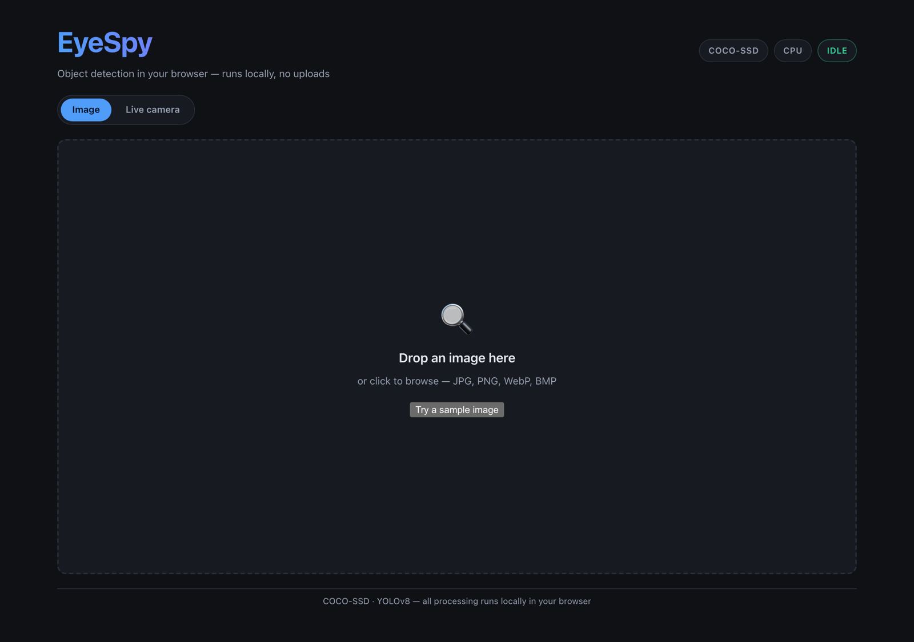
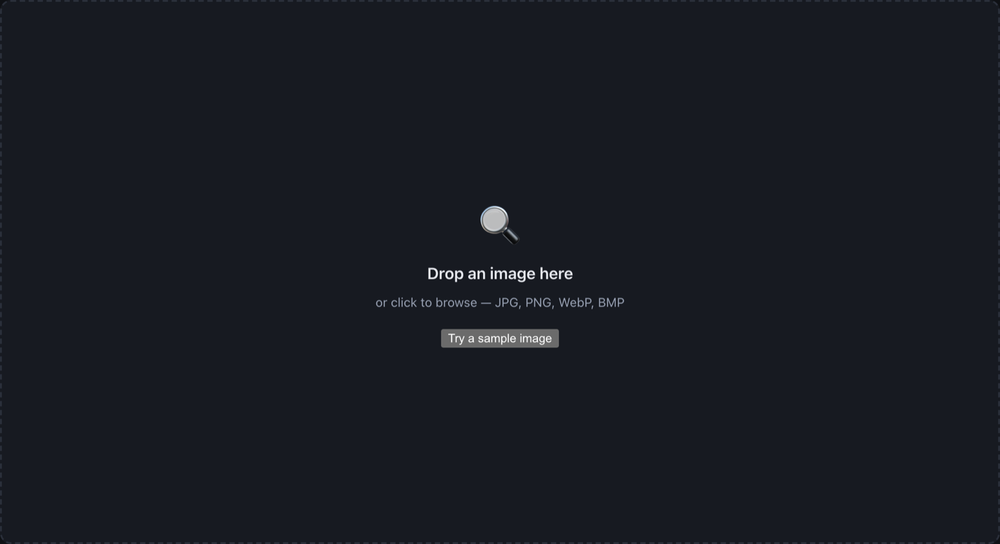
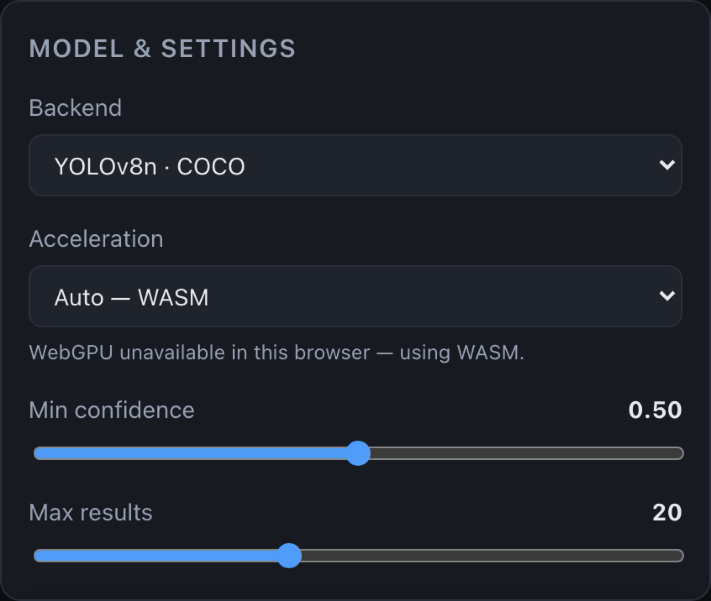
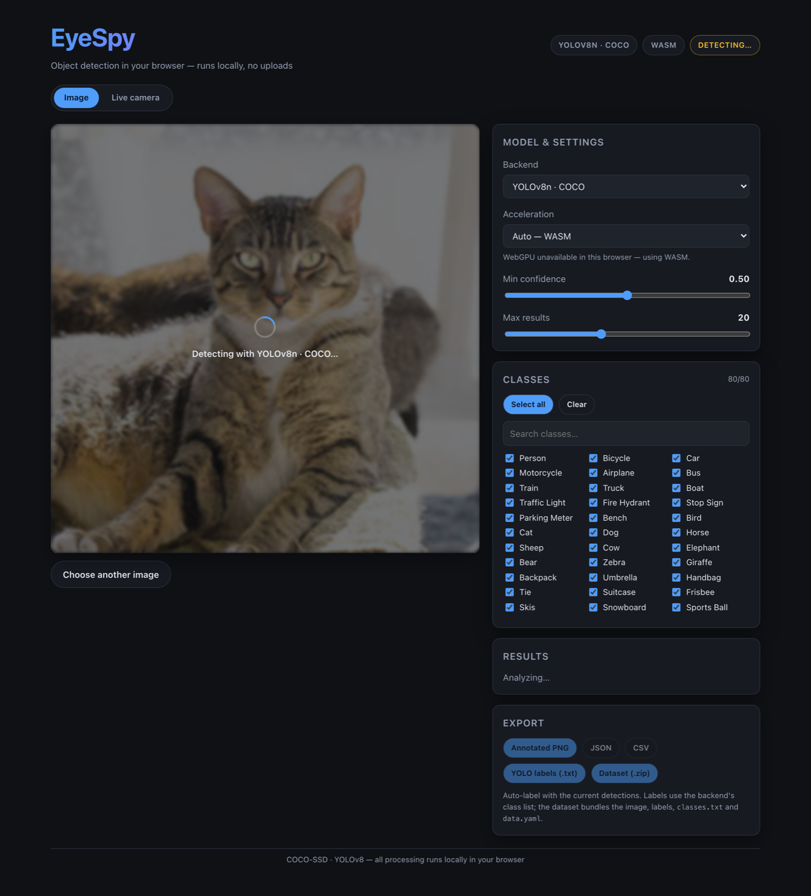
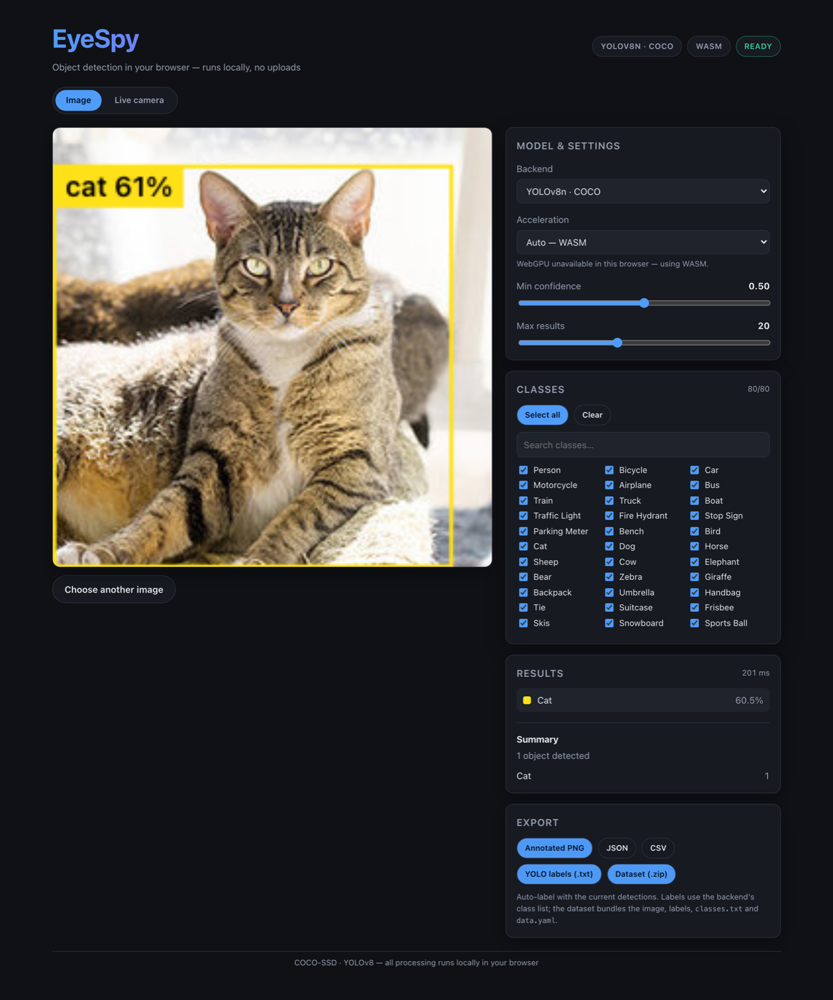
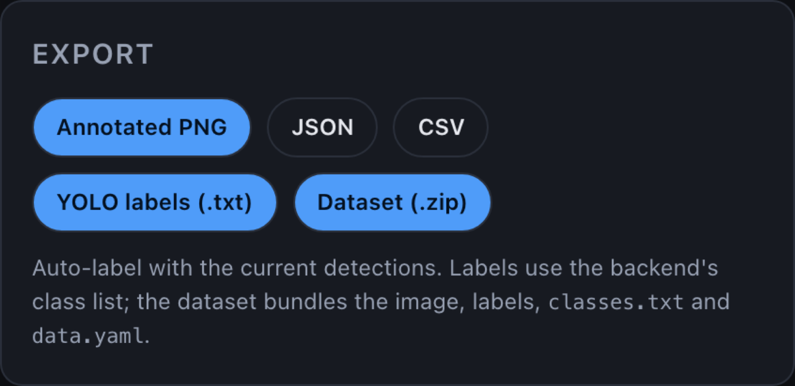

# EyeSpy

Object detection in the browser. Drop in an image and EyeSpy draws boxes around
the objects it finds — all processing runs locally on your machine, with no
uploads and no GPU required.

EyeSpy is a React port of a Node.js `detect.js` CLI, and ships with two
selectable detection backends. Each backend then has its own **Acceleration**
setting:

| Backend | Model | Acceleration |
| --- | --- | --- |
| **COCO-SSD** | TensorFlow.js COCO-SSD (MobileNet v2) | Default. 80 classes; CPU or WebGL. |
| **YOLOv8n · COCO** | YOLOv8n (ONNX Runtime Web) | 80 classes; Auto (WebGPU), WASM or WebGPU. |

The YOLO row comes from the model registry in
`src/lib/detectors/yoloModels.js`, so you can add your own models — see
[Adding your own subjects](#adding-your-own-subjects).

## Features

- Runs entirely in the browser — images never leave your device
- One backend dropdown, one Acceleration dropdown — CPU/WebGL for COCO-SSD,
  WASM/WebGPU for YOLO
- Drag & drop or file picker, plus a bundled sample image
- Live camera mode — continuous detection on your webcam feed with a live FPS
  counter
- Bounding boxes drawn on a canvas with per-class colours
- Live confidence-threshold and max-results controls
- Classes filter — pick subjects by category, by name, or search; or select all
- Export — download the annotated image (PNG) or the results as JSON / CSV
- Auto-label — turn the current detections into a YOLO training sample: a
  labels `.txt`, or a full dataset `.zip` (image + labels + `classes.txt` +
  `data.yaml`)
- Optional WebGPU acceleration for the YOLO backend, with automatic fallback to
  WASM when no GPU adapter is available
- Per-image summary with detection counts by class, and inference time
- Bring your own model: register a self-trained YOLO model to detect your own
  subjects (see [Adding your own subjects](#adding-your-own-subjects))

## Getting started

Requires Node.js 18+.

```bash
npm install
npm run dev
```

Then open the printed URL (usually http://localhost:5173). Click **Try a sample
image**, drop in your own, or switch to **Live camera** to detect on your webcam.

### Production build

```bash
npm run build
npm run preview
```

## Quick tour

A one-image walkthrough using the bundled sample photo. (The Model & settings
panel appears once an image is loaded.)

**1. Start** — the app opens on the Image tab with a drop zone.



**2. Choose an image** — drag & drop a file, click to browse, or click **Try a
sample image**.



**3. Choose a model** — pick a **Backend** (COCO-SSD, or a YOLO model) and an
**Acceleration**. Changing the backend re-runs detection automatically.



**4. Watch it detect** — a spinner overlays the image while the model runs. The
status badge reads `detecting…`.



**5. Result** — boxes are drawn over the image, and the Results panel lists each
object with its confidence, plus a per-class summary and the inference time.
Tune **Min confidence**, **Max results** and the **Classes** filter to refine.



**6. Export** — download the annotated **PNG**, the results as **JSON** / **CSV**,
or auto-label the detection as a YOLO **labels `.txt`** / **Dataset `.zip`** for
training your own model.



## How it works

- `src/lib/detect.js` is the facade: it maps a backend id to a detector module
  and exposes `runDetection(id, image, options)`. Each backend is imported
  dynamically, so TensorFlow.js and onnxruntime-web are code-split and only
  downloaded when that backend is first used.
- `src/lib/detectors/coco.js` — TensorFlow.js COCO-SSD. The Acceleration
  setting picks its tf.js backend (`cpu` / `webgl`); `ACCELERATION` in
  `detect.js` holds the choices for each family.
- `src/lib/detectors/yolo.js` — any registered YOLO model via onnxruntime-web:
  letterbox preprocessing, raw-tensor decoding and class-wise NMS
  (`yoloPost.js`). Models come from `src/lib/detectors/yoloModels.js`, one
  backend per entry. The execution provider is selectable per run (`wasm` or
  `webgpu`); `src/lib/capabilities.js` detects whether WebGPU is usable.
- `classesForBackend(id)` / `categoriesForBackend(id)` in `detect.js` give the
  active backend's class list (and optional categories) for the Classes filter.
- `src/App.jsx` loads the image into an `HTMLImageElement`, runs detection, and
  keeps raw predictions so the confidence and class filters update instantly.
- `src/components/LiveStage.jsx` drives live camera mode: `getUserMedia`, a
  sequential detect-then-draw loop (one frame in flight), and an FPS counter.
  The video element is shown directly and boxes are overlaid on a canvas sized
  to the video's native resolution. `src/lib/canvas.js` accepts video elements
  so the ONNX backend can preprocess frames too.
- `src/lib/draw.js` paints boxes + labels onto a 2D context; the on-screen
  `src/components/DetectionCanvas.jsx` and the export renderer both use it, so
  they always match.
- `src/lib/export.js` builds the annotated PNG, and serializes detections to
  JSON/CSV; `src/components/ExportPanel.jsx` is the export UI.
- `src/lib/dataset.js` auto-labels the current detections as YOLO-format lines
  (`class_index cx cy w h`, normalised) and assembles a dataset (image, labels,
  `classes.txt`, `data.yaml`); `src/lib/zip.js` is a tiny STORE-mode ZIP writer
  so the dataset downloads as one file without an extra dependency.
- `src/components/ResultsPanel.jsx` lists detections and the summary;
  `src/components/ClassFilter.jsx` is the class/subject picker.

### Model & WASM hosting

- The YOLOv8n weights live in `public/models/yolov8n.onnx` so the ONNX backend
  works without a remote download.
- onnxruntime-web is imported via its `/wasm` subpath, so Vite bundles the
  matching WASM binary as an asset and rewrites the runtime URL — no CDN and no
  manual WASM hosting required.
- The WebGPU build (`onnxruntime-web/webgpu`) is imported *lazily*, only when
  WebGPU is actually selected, so the default WASM path never downloads the
  larger WebGPU runtime.

## Adding your own subjects

The COCO backends can only ever report the 80 COCO classes. To detect your own
subjects, drop in a YOLO model trained on them — it becomes a selectable
backend with its own class list and Classes filter.

To bootstrap that training set, use an existing model to **auto-label**: run a
detection, tune the confidence/Classes filters, then **Export → Dataset (.zip)**.
The archive holds the image, its YOLO labels, `classes.txt` and `data.yaml`,
ready to hand to the trainer above.

1. **Train** a YOLOv8 / YOLO11 detection model on your labelled images, e.g.
   with [Ultralytics](https://docs.ultralytics.com):

   ```bash
   yolo detect train model=yolo11n.pt data=my-dataset.yaml imgsz=640
   ```

2. **Export** it to ONNX with a fixed square input (the standard Ultralytics
   detection export — output shape `[1, 4 + numClasses, numAnchors]`, with no
   objectness channel):

   ```bash
   yolo export model=runs/detect/train/weights/best.pt format=onnx imgsz=640 opset=12
   ```

3. **Copy** the resulting `.onnx` into `public/models/`.

4. **Register** it in `src/lib/detectors/yoloModels.js` — add one entry with the
   weight file's `url`, the `inputSize`, and a `labels` array (one name per
   class, in training order):

   ```js
   {
     id: 'my-model',
     label: 'My model',
     url: 'models/my-model.onnx',
     inputSize: 640,
     labels: ['forklift', 'pallet', 'wine bottle'],
   }
   ```

That is the whole change — no other code edits. The model appears in the
Backend dropdown and its labels populate the Classes filter. The number of decode
anchors is derived from `inputSize` (640 → 8400, 320 → 2100); set `numAnchors`
explicitly if you use a different scheme. Only the YOLOv8 / YOLO11 detection
output format is supported (other exports, e.g. YOLOv5 with an objectness
channel, are not).

> Want to detect *anything* you describe at runtime, with no training? That
> needs a zero-shot detector (OWLv2 / Grounding DINO) — much heavier and much
> happier on WebGPU. It was prototyped here and removed as too heavy for the
> WASM path.

## Notes

- On first use of the COCO-SSD backend its weights are downloaded from a CDN and
  cached by the browser.
- COCO-SSD's WebGL acceleration needs a WebGL-capable browser and falls back to
  CPU when it isn't available; CPU works everywhere.
- The ONNX/WASM backend needs SIMD (available in all current evergreen browsers).
- WebGPU acceleration is offered for the YOLO backend when the browser can
  provide a GPU adapter; otherwise the app falls back to WASM automatically.
- Live camera mode needs camera permission and a secure context (localhost or
  HTTPS). Exporting is image-only; the annotated PNG / JSON / CSV buttons are
  hidden while the camera is running.

## Credits

Built with [React](https://react.dev), [Vite](https://vite.dev),
[TensorFlow.js](https://www.tensorflow.org/js) / COCO-SSD, and
[ONNX Runtime Web](https://onnxruntime.ai) / YOLOv8.
